# 基于SpringBoot的在线视频教育平台的设计与实现

> 🎓 **计算机毕业设计 · 基于SpringBoot的在线视频教育平台的设计与实现**
>
> 本仓库只放**项目介绍 + 运行截图**（截图是站点带水印的原图，存在仓库 `images/` 里）。
>
> 👉 **完整可运行源码 / 数据库脚本 / 部署文档：[点我获取](https://geekcode.top/archives/%E5%9F%BA%E4%BA%8ESpringBoot%E7%9A%84%E5%9C%A8%E7%BA%BF%E8%A7%86%E9%A2%91%E6%95%99%E8%82%B2%E5%B9%B3%E5%8F%B0%E7%9A%84%E8%AE%BE%E8%AE%A1%E4%B8%8E%E5%AE%9E%E7%8E%B0?utm_source=github)**
>
> 💬 咨询微信：**ir9372**　|　🌐 更多项目：[极客代码 geekcode.top](https://geekcode.top/?utm_source=github)
>
> 📌 项目详情页：<https://geekcode.top/archives/%E5%9F%BA%E4%BA%8ESpringBoot%E7%9A%84%E5%9C%A8%E7%BA%BF%E8%A7%86%E9%A2%91%E6%95%99%E8%82%B2%E5%B9%B3%E5%8F%B0%E7%9A%84%E8%AE%BE%E8%AE%A1%E4%B8%8E%E5%AE%9E%E7%8E%B0?utm_source=github>

<table><td width="230" align="center"> <b>扫码加微信 ir9372</b></td><td valign="middle">📦 源码 = 项目介绍 + 全部运行截图 + 数据库 + 部署文档 👉 点上方任意截图，直接跳到 <b>极客代码 geekcode.top</b> 详情页</td></table>

---

<h1>基于SpringBoot的在线视频教育平台的设计与实现</h1>
<h2>项目概述</h2>

本项目为在线视频教育平台毕业设计项目，面向课程资源展示、用户浏览、订单管理与后台维护场景。系统提供前台课程信息浏览、课程类型与教师展示、课程评论查看、个人中心、我的订单、我的地址、我的收藏、购物车等功能，并提供后台用户、教师、课程信息、课程类型、评论、订单、收藏、在线客服、轮播图与配置管理。项目采用 Vue 前端、Spring Boot 后端、MyBatis-Plus 持久层、Shiro 认证授权与 MySQL 数据库，实现前后端一体化的课程信息管理与用户服务流程，适用于平台管理员、课程资源管理者与普通用户。

<h2>技术架构</h2>

系统采用前后端一体化结构，前端负责页面展示与用户交互，后端负责业务接口、权限控制、数据访问与系统配置管理。

前端部分采用 Vue 集成方案，页面导航包括课程信息、个人中心、我的订单、我的地址、我的收藏等。后台管理端通过路由组织管理模块，包括 <code>/yonghu</code>、<code>/chat</code>、<code>/orders/:status</code>、<code>/jiaoshi</code>、<code>/storeup</code>、<code>/discusskechengxinxi</code>、<code>/kechengxinxi</code>、<code>/config</code>、<code>/kechengleixing</code> 等路径。

后端采用 Spring Boot 构建 Web 服务，通过 Controller 层提供接口能力。核心控制器包括 <code>AddressController</code>、<code>CartController</code>、<code>ChatController</code>、<code>CommonController</code>、<code>ConfigController</code>、<code>DiscusskechengxinxiController</code>、<code>FileController</code>、<code>JiaoshiController</code>、<code>KechengleixingController</code>、<code>KechengxinxiController</code>、<code>OrdersController</code>、<code>StoreupController</code>。

持久层采用 MyBatis-Plus 与 MyBatis Spring Boot 集成方式，数据库使用 MySQL，并通过 MySQL Connector Java 建立数据访问连接。安全认证与授权采用 Shiro，用于登录、会话与访问控制。公共组件依赖 <code>commons-lang3</code>、<code>validation-api</code> 等，用于通用工具处理与参数校验。

<a href="https://geekcode.top/archives/%E5%9F%BA%E4%BA%8ESpringBoot%E7%9A%84%E5%9C%A8%E7%BA%BF%E8%A7%86%E9%A2%91%E6%95%99%E8%82%B2%E5%B9%B3%E5%8F%B0%E7%9A%84%E8%AE%BE%E8%AE%A1%E4%B8%8E%E5%AE%9E%E7%8E%B0?utm_source=github" title="查看完整源码">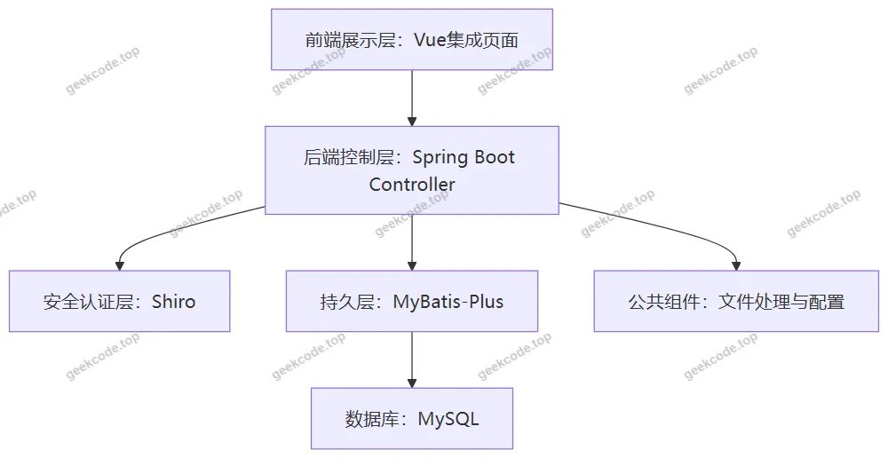</a>

数据库设计围绕平台业务对象组织，主要包括用户、教师、课程信息、课程类型、订单、购物车、收藏、地址、课程评论、在线客服、系统配置等数据模块。各模块通过课程信息、用户、订单、收藏等核心业务对象建立联系，支撑前台浏览、个人中心管理与后台统一维护。

<h2>功能模块</h2>
<h3>前台用户端功能模块</h3>
<ul>
<li><strong>前台首页</strong>：展示平台入口与课程信息相关内容，作为用户进入系统的起始页面。</li>
<li><strong>用户注册与登录</strong>：提供用户注册与登录入口，用于进入个人中心及相关用户功能。</li>
<li><strong>课程信息列表</strong>：展示课程信息集合，支持用户浏览平台中的课程资源。</li>
<li><strong>课程信息详情</strong>：展示单个课程信息的详细内容，帮助用户了解课程资源。</li>
<li><strong>课程类型列表</strong>：展示课程分类信息，用于对课程信息进行类别化浏览。</li>
<li><strong>教师列表</strong>：展示教师信息，用于查看平台中的教师资料。</li>
<li><strong>课程信息评论列表</strong>：展示课程评论信息，用于查看课程相关评论内容。</li>
<li><strong>课程信息评论详情</strong>：展示单条评论的详细内容。</li>
<li><strong>个人中心</strong>：提供用户个人信息与个人业务功能的集中入口。</li>
<li><strong>我的订单</strong>：展示用户相关订单信息，支持订单记录查看。</li>
<li><strong>我的地址</strong>：展示用户地址信息，支持个人地址管理。</li>
<li><strong>我的收藏</strong>：展示用户收藏的课程信息或其他收藏内容。</li>
<li><strong>购物车列表</strong>：展示购物车中的课程信息内容，用于形成购买或下单前的数据集合。</li>
</ul>
<h3>后台管理端功能模块</h3>
<ul>
<li><strong>后台登录页</strong>：提供管理员进入后台管理系统的登录入口。</li>
<li><strong>后台首页</strong>：展示后台管理主界面，作为各管理模块的导航入口。</li>
<li><strong>用户管理</strong>：对平台用户信息进行维护与管理。</li>
<li><strong>教师管理</strong>：对教师信息进行维护与管理。</li>
<li><strong>课程信息管理</strong>：对课程信息内容进行新增、修改、查询、删除等后台维护操作。</li>
<li><strong>课程类型管理</strong>：对课程分类信息进行维护与管理。</li>
<li><strong>课程信息评论管理</strong>：对课程评论信息进行后台管理与查看。</li>
<li><strong>订单管理</strong>：对订单数据进行管理，支持按订单状态进行区分处理。</li>
<li><strong>在线客服</strong>：对平台聊天或客服相关信息进行后台管理。</li>
<li><strong>我的收藏管理</strong>：对收藏数据进行后台管理。</li>
<li><strong>轮播图管理</strong>：对前台展示相关轮播图内容进行维护。</li>
<li><strong>系统配置管理</strong>：对系统配置信息进行维护与管理。</li>
</ul>
<h2>用户角色与权限</h2>
<table>
<thead>
<tr>
<th>角色</th>
<th>访问入口</th>
<th>可访问功能模块</th>
</tr>
</thead>
<tbody><tr>
<td>普通用户</td>
<td>前台登录页、前台注册页</td>
<td>前台首页、课程信息列表、课程信息详情、课程类型列表、教师列表、课程信息评论列表、课程信息评论详情、个人中心、我的订单、我的地址、我的收藏、购物车列表</td>
</tr>
<tr>
<td>系统管理员</td>
<td>后台登录页</td>
<td>后台首页、用户管理、教师管理、课程信息管理、课程类型管理、课程信息评论管理、订单管理、在线客服、我的收藏管理、轮播图管理、系统配置管理</td>
</tr>
<tr>
<td>教师</td>
<td>前台教师列表、后台教师管理</td>
<td>教师信息可作为平台数据对象在前台教师列表中展示，并在后台教师管理模块中由管理员维护；现有项目信息未体现教师独立登录入口</td>
</tr>
</tbody></table>

普通用户主要使用前台页面完成课程信息浏览、评论查看、个人中心、订单查看、地址管理、收藏管理与购物车查看等操作。系统管理员主要使用后台管理端完成用户、教师、课程信息、课程类型、评论、订单、收藏、在线客服、轮播图与系统配置等模块的管理工作。

<h2>项目特色与创新点</h2>
<ul>
<li><strong>前后端一体化管理</strong>：系统同时具备前台用户端页面与后台管理端路由，能够覆盖课程信息浏览、用户个人业务管理与后台数据维护。</li>
<li><strong>课程信息业务闭环</strong>：围绕课程信息形成列表展示、详情查看、评论查看、课程类型分类、教师信息展示、购物车、订单、收藏等业务流程。</li>
<li><strong>个人中心能力完整</strong>：前台个人中心提供我的订单、我的地址、我的收藏等入口，便于用户集中管理个人业务数据。</li>
<li><strong>后台统一管理入口</strong>：后台管理端覆盖用户、教师、课程信息、课程类型、评论、订单、收藏、在线客服、轮播图与配置管理，便于管理员统一维护平台数据。</li>
<li><strong>权限控制与持久层效率</strong>：采用 Shiro 进行认证授权，采用 MyBatis-Plus 简化数据访问，提升业务接口开发与数据操作效率。</li>
<li><strong>面向课程资源展示与管理</strong>：系统重点解决课程信息展示、分类管理、评论查看、订单与收藏管理等平台基础业务需求。</li>
</ul>
<h2>部署环境</h2>
<table>
<thead>
<tr>
<th>环境</th>
<th>用途</th>
<th>版本要求</th>
</tr>
</thead>
<tbody><tr>
<td>JDK</td>
<td>后端 Java 运行环境</td>
<td>根据现有信息无法确定</td>
</tr>
<tr>
<td>MySQL</td>
<td>平台业务数据存储</td>
<td>根据现有信息无法确定</td>
</tr>
<tr>
<td>Maven</td>
<td>后端依赖管理与项目构建</td>
<td>根据现有信息无法确定</td>
</tr>
<tr>
<td>Node.js</td>
<td>前端 Vue 集成项目构建与运行</td>
<td>根据现有信息无法确定</td>
</tr>
<tr>
<td>Spring Boot Web 服务</td>
<td>后端接口运行与页面访问服务</td>
<td>根据现有信息无法确定</td>
</tr>
<tr>
<td>Shiro</td>
<td>登录认证与访问控制</td>
<td>根据现有信息无法确定</td>
</tr>
<tr>
<td>MyBatis-Plus</td>
<td>数据持久层与业务对象映射</td>
<td>根据现有信息无法确定</td>
</tr>
</tbody></table>
<h2>五、技术特性</h2>
<ul>
<li>前后端集成部署，前端资源打包至后端 static 目录</li>
<li>使用 MyBatis-Plus 简化数据访问层开发</li>
<li>集成 Shiro 权限框架实现角色权限控制</li>
</ul>
<h2>六、功能模块截图</h2>
<h3>前台用户端</h3>
<h4>前台首页</h4>

<a href="https://geekcode.top/archives/%E5%9F%BA%E4%BA%8ESpringBoot%E7%9A%84%E5%9C%A8%E7%BA%BF%E8%A7%86%E9%A2%91%E6%95%99%E8%82%B2%E5%B9%B3%E5%8F%B0%E7%9A%84%E8%AE%BE%E8%AE%A1%E4%B8%8E%E5%AE%9E%E7%8E%B0?utm_source=github" title="查看完整源码">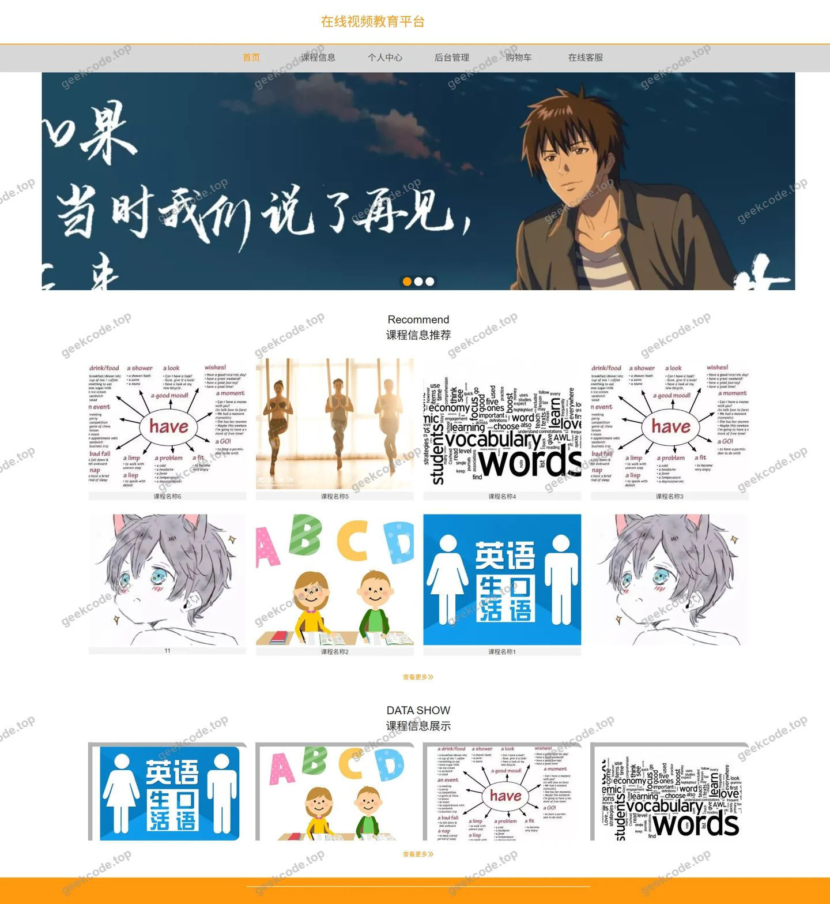</a>

<h4>前台登录页</h4>

<h4>前台注册页</h4>

<a href="https://geekcode.top/archives/%E5%9F%BA%E4%BA%8ESpringBoot%E7%9A%84%E5%9C%A8%E7%BA%BF%E8%A7%86%E9%A2%91%E6%95%99%E8%82%B2%E5%B9%B3%E5%8F%B0%E7%9A%84%E8%AE%BE%E8%AE%A1%E4%B8%8E%E5%AE%9E%E7%8E%B0?utm_source=github" title="查看完整源码">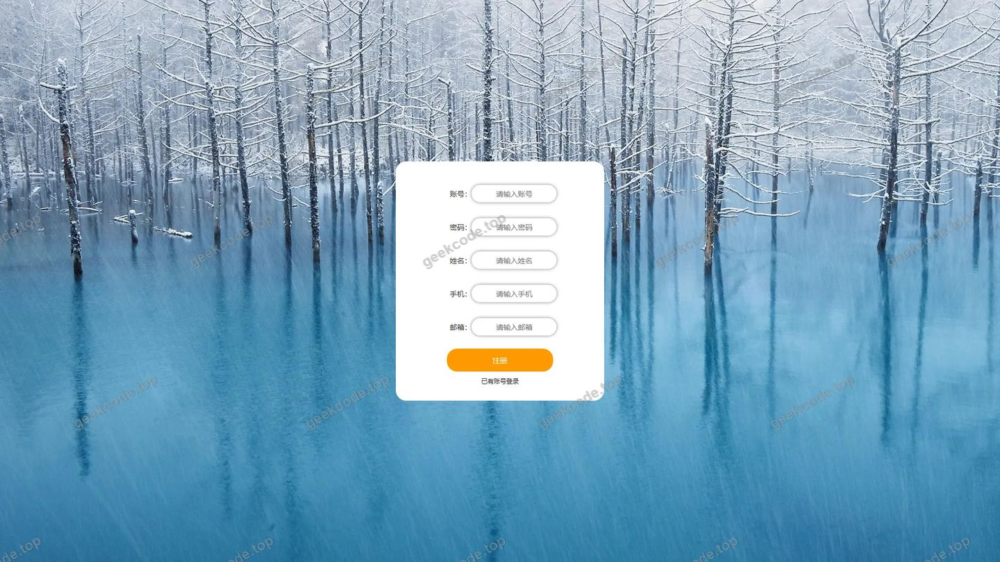</a>

<h4>前台-课程信息列表</h4>

<a href="https://geekcode.top/archives/%E5%9F%BA%E4%BA%8ESpringBoot%E7%9A%84%E5%9C%A8%E7%BA%BF%E8%A7%86%E9%A2%91%E6%95%99%E8%82%B2%E5%B9%B3%E5%8F%B0%E7%9A%84%E8%AE%BE%E8%AE%A1%E4%B8%8E%E5%AE%9E%E7%8E%B0?utm_source=github" title="查看完整源码">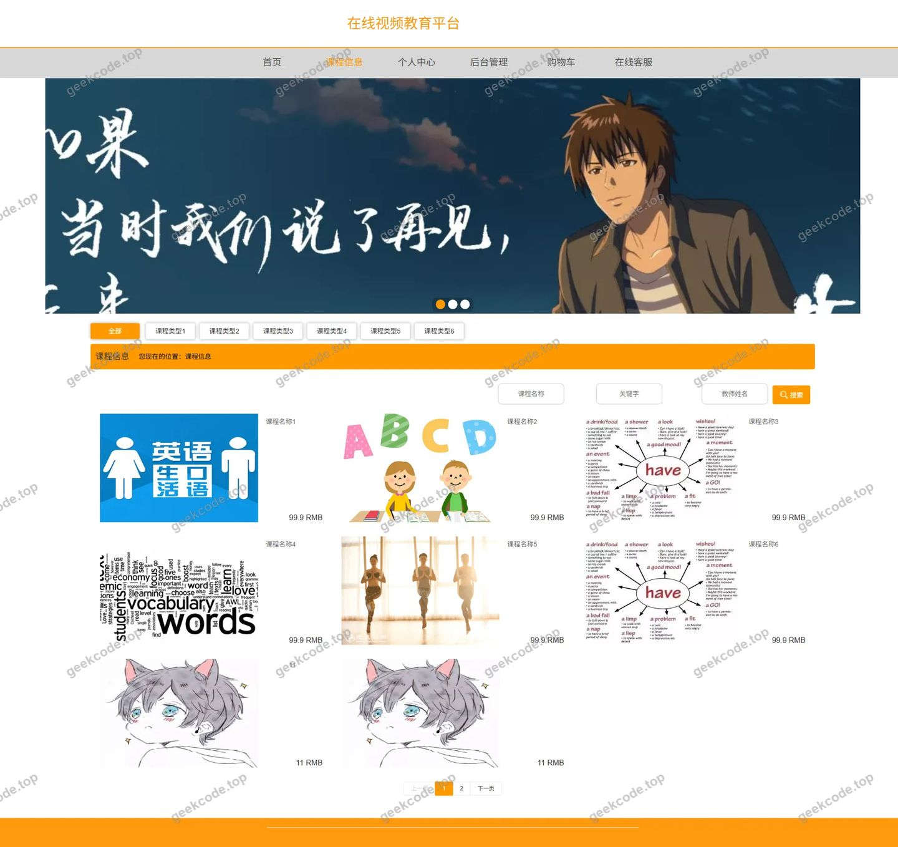</a>

<h4>前台-课程信息评论列表</h4>

<h4>前台个人中心</h4>

<a href="https://geekcode.top/archives/%E5%9F%BA%E4%BA%8ESpringBoot%E7%9A%84%E5%9C%A8%E7%BA%BF%E8%A7%86%E9%A2%91%E6%95%99%E8%82%B2%E5%B9%B3%E5%8F%B0%E7%9A%84%E8%AE%BE%E8%AE%A1%E4%B8%8E%E5%AE%9E%E7%8E%B0?utm_source=github" title="查看完整源码">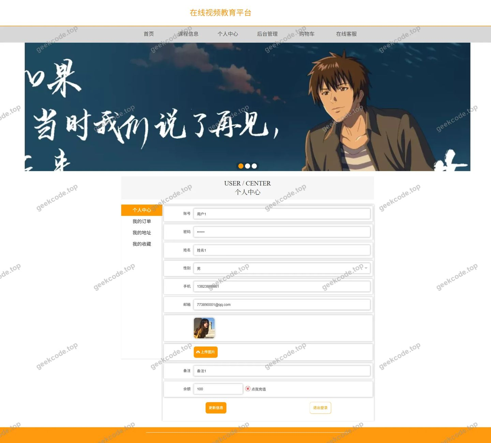</a>

<h4>前台-我的地址列表</h4>

<a href="https://geekcode.top/archives/%E5%9F%BA%E4%BA%8ESpringBoot%E7%9A%84%E5%9C%A8%E7%BA%BF%E8%A7%86%E9%A2%91%E6%95%99%E8%82%B2%E5%B9%B3%E5%8F%B0%E7%9A%84%E8%AE%BE%E8%AE%A1%E4%B8%8E%E5%AE%9E%E7%8E%B0?utm_source=github" title="查看完整源码">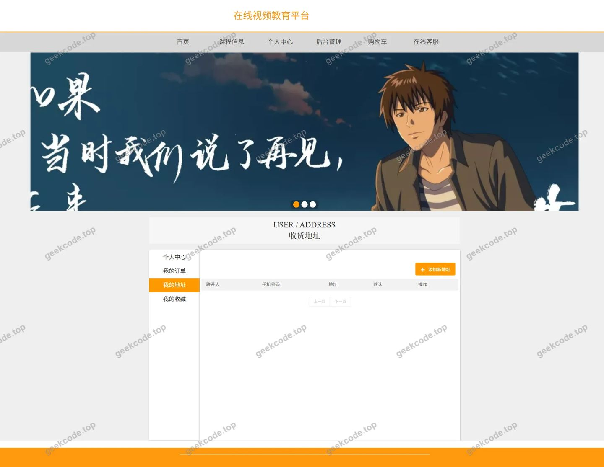</a>

<h4>前台-我的订单列表</h4>

<h4>前台-我的收藏列表</h4>

<h4>前台-课程信息-详情</h4>

<a href="https://geekcode.top/archives/%E5%9F%BA%E4%BA%8ESpringBoot%E7%9A%84%E5%9C%A8%E7%BA%BF%E8%A7%86%E9%A2%91%E6%95%99%E8%82%B2%E5%B9%B3%E5%8F%B0%E7%9A%84%E8%AE%BE%E8%AE%A1%E4%B8%8E%E5%AE%9E%E7%8E%B0?utm_source=github" title="查看完整源码">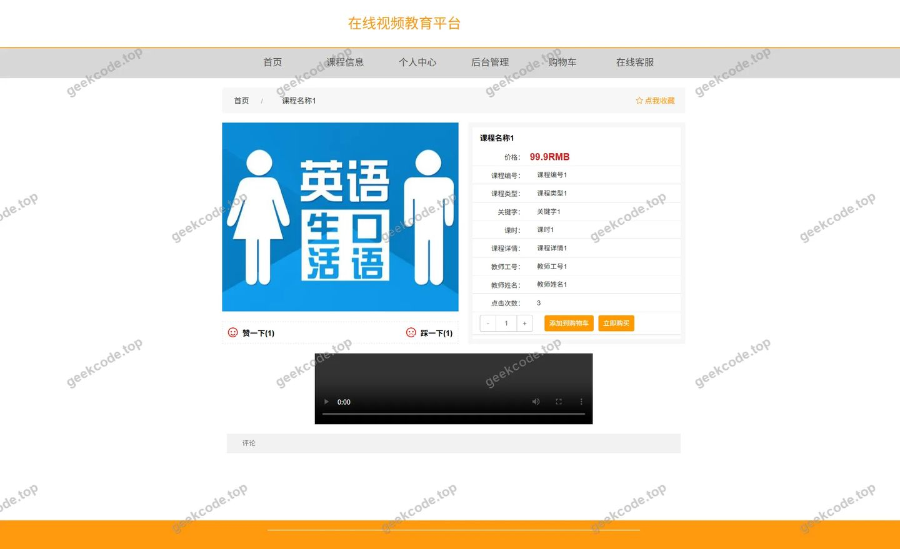</a>

<h4>前台-教师列表</h4>

<h4>前台-课程类型列表</h4>

<h4>前台-购物车列表</h4>

<h4>前台-课程信息评论-详情</h4>

<a href="https://geekcode.top/archives/%E5%9F%BA%E4%BA%8ESpringBoot%E7%9A%84%E5%9C%A8%E7%BA%BF%E8%A7%86%E9%A2%91%E6%95%99%E8%82%B2%E5%B9%B3%E5%8F%B0%E7%9A%84%E8%AE%BE%E8%AE%A1%E4%B8%8E%E5%AE%9E%E7%8E%B0?utm_source=github" title="查看完整源码">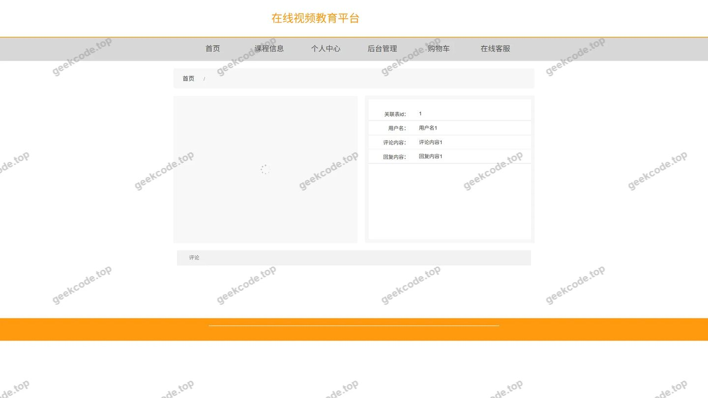</a>

<h3>后台管理端</h3>
<h4>后台-在线客服</h4>

<a href="https://geekcode.top/archives/%E5%9F%BA%E4%BA%8ESpringBoot%E7%9A%84%E5%9C%A8%E7%BA%BF%E8%A7%86%E9%A2%91%E6%95%99%E8%82%B2%E5%B9%B3%E5%8F%B0%E7%9A%84%E8%AE%BE%E8%AE%A1%E4%B8%8E%E5%AE%9E%E7%8E%B0?utm_source=github" title="查看完整源码">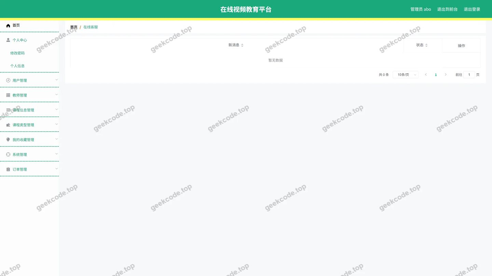</a>

<h4>后台-系统配置</h4>

<a href="https://geekcode.top/archives/%E5%9F%BA%E4%BA%8ESpringBoot%E7%9A%84%E5%9C%A8%E7%BA%BF%E8%A7%86%E9%A2%91%E6%95%99%E8%82%B2%E5%B9%B3%E5%8F%B0%E7%9A%84%E8%AE%BE%E8%AE%A1%E4%B8%8E%E5%AE%9E%E7%8E%B0?utm_source=github" title="查看完整源码">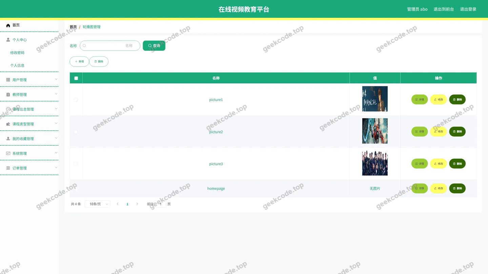</a>

<h4>后台-课程信息评论</h4>

<a href="https://geekcode.top/archives/%E5%9F%BA%E4%BA%8ESpringBoot%E7%9A%84%E5%9C%A8%E7%BA%BF%E8%A7%86%E9%A2%91%E6%95%99%E8%82%B2%E5%B9%B3%E5%8F%B0%E7%9A%84%E8%AE%BE%E8%AE%A1%E4%B8%8E%E5%AE%9E%E7%8E%B0?utm_source=github" title="查看完整源码">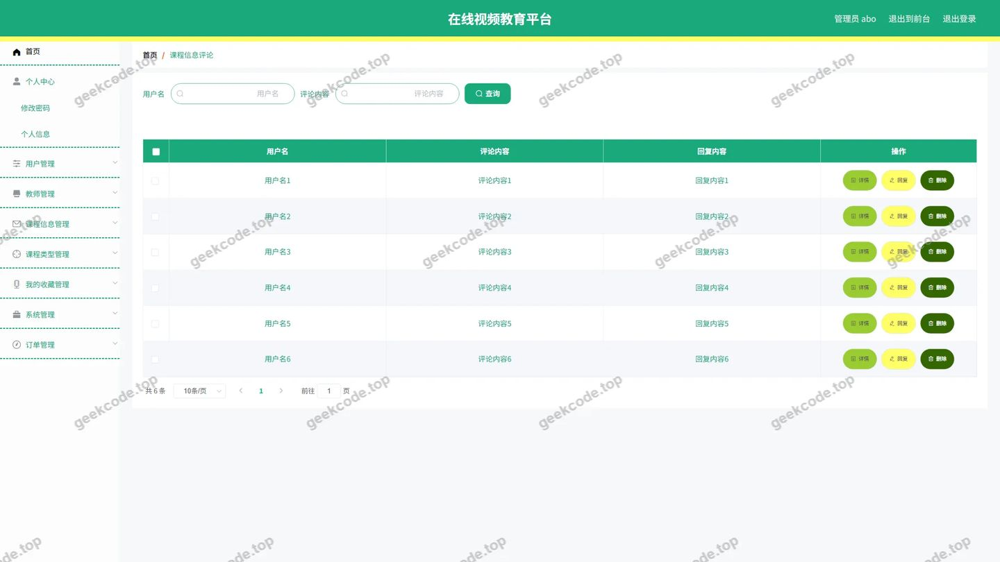</a>

<h4>后台首页</h4>

<a href="https://geekcode.top/archives/%E5%9F%BA%E4%BA%8ESpringBoot%E7%9A%84%E5%9C%A8%E7%BA%BF%E8%A7%86%E9%A2%91%E6%95%99%E8%82%B2%E5%B9%B3%E5%8F%B0%E7%9A%84%E8%AE%BE%E8%AE%A1%E4%B8%8E%E5%AE%9E%E7%8E%B0?utm_source=github" title="查看完整源码">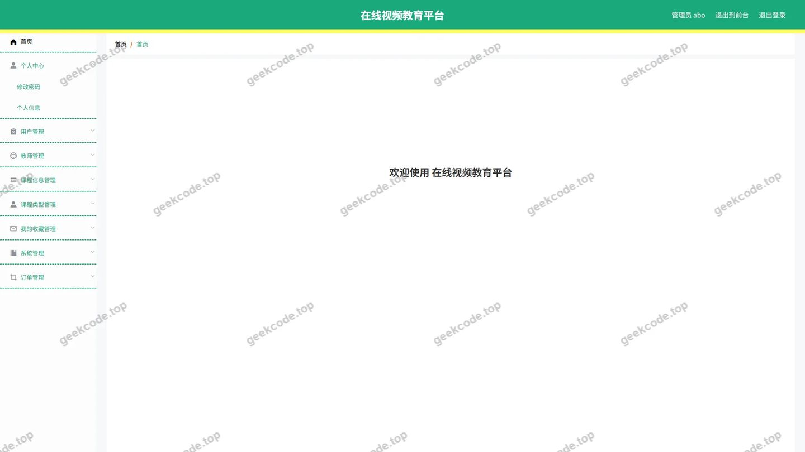</a>

<h4>后台-教师</h4>

<a href="https://geekcode.top/archives/%E5%9F%BA%E4%BA%8ESpringBoot%E7%9A%84%E5%9C%A8%E7%BA%BF%E8%A7%86%E9%A2%91%E6%95%99%E8%82%B2%E5%B9%B3%E5%8F%B0%E7%9A%84%E8%AE%BE%E8%AE%A1%E4%B8%8E%E5%AE%9E%E7%8E%B0?utm_source=github" title="查看完整源码">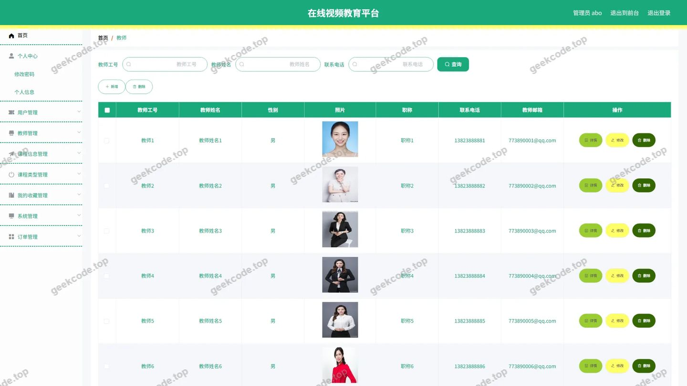</a>

<h4>后台-课程类型</h4>

<a href="https://geekcode.top/archives/%E5%9F%BA%E4%BA%8ESpringBoot%E7%9A%84%E5%9C%A8%E7%BA%BF%E8%A7%86%E9%A2%91%E6%95%99%E8%82%B2%E5%B9%B3%E5%8F%B0%E7%9A%84%E8%AE%BE%E8%AE%A1%E4%B8%8E%E5%AE%9E%E7%8E%B0?utm_source=github" title="查看完整源码">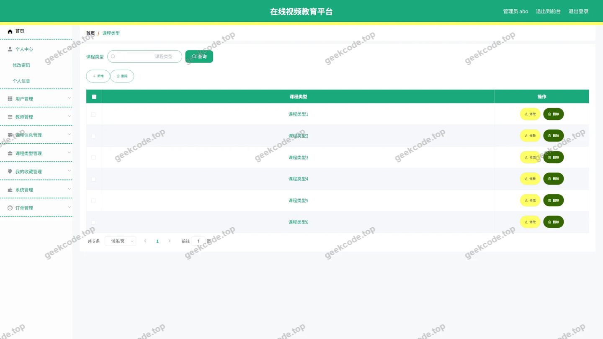</a>

<h4>后台-课程信息</h4>

<a href="https://geekcode.top/archives/%E5%9F%BA%E4%BA%8ESpringBoot%E7%9A%84%E5%9C%A8%E7%BA%BF%E8%A7%86%E9%A2%91%E6%95%99%E8%82%B2%E5%B9%B3%E5%8F%B0%E7%9A%84%E8%AE%BE%E8%AE%A1%E4%B8%8E%E5%AE%9E%E7%8E%B0?utm_source=github" title="查看完整源码">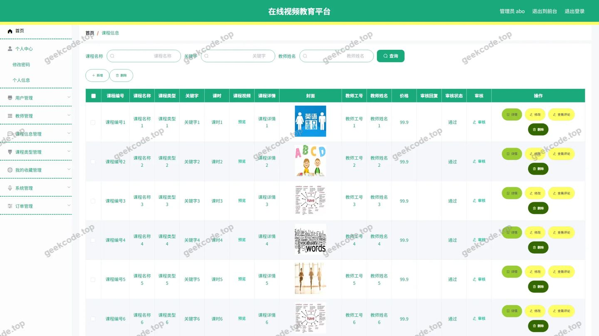</a>

<h4>后台-登录</h4>

<a href="https://geekcode.top/archives/%E5%9F%BA%E4%BA%8ESpringBoot%E7%9A%84%E5%9C%A8%E7%BA%BF%E8%A7%86%E9%A2%91%E6%95%99%E8%82%B2%E5%B9%B3%E5%8F%B0%E7%9A%84%E8%AE%BE%E8%AE%A1%E4%B8%8E%E5%AE%9E%E7%8E%B0?utm_source=github" title="查看完整源码">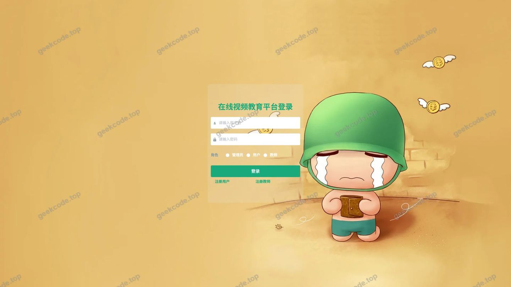</a>

<h4>后台-订单-状态</h4>

<a href="https://geekcode.top/archives/%E5%9F%BA%E4%BA%8ESpringBoot%E7%9A%84%E5%9C%A8%E7%BA%BF%E8%A7%86%E9%A2%91%E6%95%99%E8%82%B2%E5%B9%B3%E5%8F%B0%E7%9A%84%E8%AE%BE%E8%AE%A1%E4%B8%8E%E5%AE%9E%E7%8E%B0?utm_source=github" title="查看完整源码">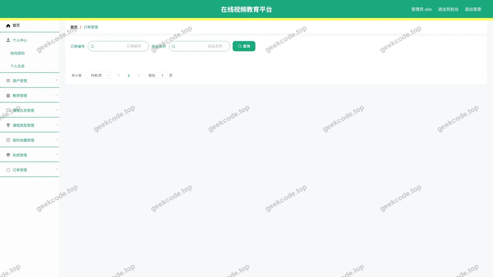</a>

<h4>后台-收藏</h4>

<a href="https://geekcode.top/archives/%E5%9F%BA%E4%BA%8ESpringBoot%E7%9A%84%E5%9C%A8%E7%BA%BF%E8%A7%86%E9%A2%91%E6%95%99%E8%82%B2%E5%B9%B3%E5%8F%B0%E7%9A%84%E8%AE%BE%E8%AE%A1%E4%B8%8E%E5%AE%9E%E7%8E%B0?utm_source=github" title="查看完整源码">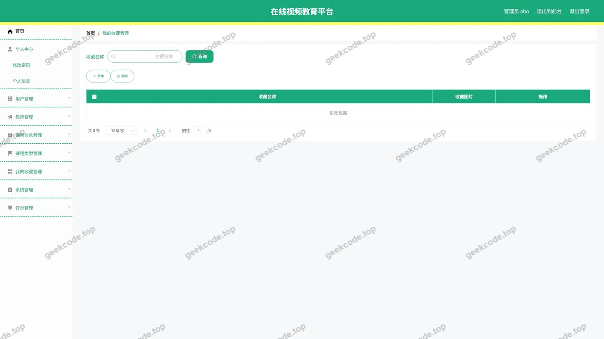</a>

---

## 获取完整源码

| 项目 | 说明 |
| --- | --- |
| 项目名 | 基于SpringBoot的在线视频教育平台的设计与实现 |
| 运行截图 | 本文 25 张（站点带水印原图，仓库 `images/` 目录） |
| 完整源码 | [https://geekcode.top/archives/%E5%9F%BA%E4%BA%8ESpringBoot%E7%9A%84%E5%9C%A8%E7%BA%BF%E8%A7%86%E9%A2%91%E6%95%99%E8%82%B2%E5%B9%B3%E5%8F%B0%E7%9A%84%E8%AE%BE%E8%AE%A1%E4%B8%8E%E5%AE%9E%E7%8E%B0?utm_source=github](https://geekcode.top/archives/%E5%9F%BA%E4%BA%8ESpringBoot%E7%9A%84%E5%9C%A8%E7%BA%BF%E8%A7%86%E9%A2%91%E6%95%99%E8%82%B2%E5%B9%B3%E5%8F%B0%E7%9A%84%E8%AE%BE%E8%AE%A1%E4%B8%8E%E5%AE%9E%E7%8E%B0?utm_source=github) |
| 咨询微信 | **ir9372**（备注：jingpin-yuanma） |
| 更多项目 | [极客代码 geekcode.top](https://geekcode.top/?utm_source=github) |

> 需要源码、部署、改配置、跑不起来等问题，加微信 ir9372 沟通，说明项目名即可。
